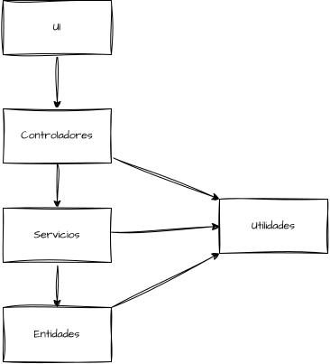

# HORNERO LAUNCHER

## Launcher de Minecraft java, seguro y de código abierto. Para jugar cualquier versión en _Windows_ y _Linux_.

### Dependencias
1. Por el momento, es necesario tener creado previamente el directorio de minecraft en tu sistema operativo.
Para eso recomiendo descargar el launcher oficial y seleccionar "Probar Beta". Para esto no es necesario comprar el juego.
2. Tener una versión de java (JRE) y tenerla configurada en el path de tu sistema.
3. Si sos desarrollador y te interesa extender las funcionalidades del proyecto, tener JDK 25, la actual en este momento.

### Arquitectura del proyecto

Decidí usar una arquitectura de 4 capas cerradas y una abierta, siendo estas las siguientes:

- Entidades: Movimientos estructurales principales de la app. Los mismos se basan en tareas asíncronas, con manejos de
hilos y Tasks de JavaFX para el flujo y las validaciones.
- Servicios: Capa de lógica de validaciones y orquestación principál.
- Controladores: Lógica directa de manejo con componentes de la UI.
- UI / Interfaz gráfica: Manejo de ventanas con JavaFX, css y fxml.
- Utilidades: Capa abierta de la que se puede acceder a diferentes helpers como DTOs, Exceptions, y con vistas de a futuro

### Flujo de comunicación
